# ⚡ Awesome Enterprise AI Engine 🤖

  <strong>A curated showcase of high-performance Enterprise AI Engines, Autonomous Agents, and Self-Hosted RAG Platforms.</strong> 
  <em>Empowering data-sovereign architectures, private enterprise copilots, and multi-agent workflow automation.</em>

  
  
  
  
  
  

---

## 📌 Table of Contents
- [🎯 Overview & Motivation](#-overview--motivation)
- [📊 Sector Overview & Market Dynamics](#-sector-overview--market-dynamics)
- [🏢 Enterprise SaaS & Hosted Platforms](#-enterprise-saas--hosted-platforms)
- [💻 Open-Source GitHub Projects](#-open-source-github-projects)
- [🤝 How to Contribute](#-how-to-contribute)
- [💖 Support & Sponsorship](#-support--sponsorship)
- [📈 Star History](#-star-history)
- [⚖️ Disclaimer](#️-disclaimer)

---

## 🎯 Overview & Motivation

Modern organizations require intelligent AI systems that can seamlessly connect to internal knowledge silos, automate high-throughput business logic, and answer complex questions with traceable evidence. This repository comprehensively tracks:

1. **Enterprise SaaS Copilots**: Scalable, fully-managed platforms engineered by tech giants with deep productivity integrations and enterprise-grade compliance.
2. **Self-Hosted & Open-Source AI Engines**: Resilient, privacy-first platforms enabling organizations to run state-of-the-art Retrieval-Augmented Generation (RAG) and autonomous agents 100% on-premises or within their private cloud (VPC)—guaranteeing complete data sovereignty and eliminating runaway per-seat SaaS costs.

---

## 📊 Sector Overview & Market Dynamics

The enterprise AI software market is estimated at approximately **$30B–$115B in 2026** and is projected to expand beyond **$500B by the early 2030s**, growing at a **30%–45% CAGR** as enterprise IT budgets pivot from exploratory copilots to production agentic workflows.

Structurally, the industry exhibits a pronounced **"barbell" market concentration**:
- **Foundation Models & Compute**: Highly concentrated among an oligopoly of hyperscalers and frontier research labs (e.g., Microsoft/OpenAI, Google, Anthropic, AWS) driving winner-takes-most platform lock-in.
- **Application & Integration Layer**: Moderately to highly fragmented. Enterprises procure an array of specialized point solutions and open-source frameworks across departmental workflows (ITSM, CRM, knowledge retrieval, customer success), creating an open playing field for modular, sovereign AI engines.

---

## 🏢 Enterprise SaaS & Hosted Platforms

*Below is a comprehensive overview of top enterprise SaaS AI engines, sorted by parent company valuation / market capitalization (descending).*

| Product | Valuation / Market Cap | Description | Pricing (Starting Tier) | Free Tier / Free Trial Limits |
|:---|:---|:---|:---|:---|
| **[Microsoft Copilot](https://www.microsoft.com/en-us/microsoft-copilot)** | ~$3.89 Trillion *(Market Cap)* | Enterprise AI assistant embedded across Microsoft 365 (Word, Excel, Teams, Outlook) and Windows. Grounded in organizational data via Microsoft Graph. | **$30/user/month** (annual commitment, requires qualifying Microsoft 365 E3/E5/Business base license) | **30-day free trial** available for underlying M365 Business Standard/Premium base suites (up to 25 seats); Copilot web chat is free with Entra ID |
| **[Google Gemini Enterprise](https://cloud.google.com/gemini)** | ~$3.60 Trillion *(Market Cap - Alphabet)* | Enterprise AI assistant natively integrated across Google Workspace and Google Cloud. Grounded in enterprise docs with Vertex AI access. | **$21/user/month** (annual commitment for Gemini Business standalone/add-on; native Workspace tiers start at $7/user/month) | **14-day free trial** for Google Workspace plans; **30-day trial** available for Gemini Enterprise add-on evaluations |
| **[Claude for Work](https://www.anthropic.com/)** | ~$1.40 Trillion *(Valuation)* | Enterprise Claude workspace with admin console, centralized billing, SSO, and strict no-training data privacy guarantees. | **$20/user/month** ($25 billed monthly, minimum 2 seats for Claude Team Standard tier) | **Free forever plan** with basic Claude access and daily dynamic messaging limits; no time-limited trial for Team tier (PoC available via sales) |
| **[OpenAI ChatGPT Enterprise](https://openai.com/enterprise)** | ~$1.25 Trillion *(Valuation)* | Enterprise-grade ChatGPT featuring advanced administrative controls, unlimited high-speed model access, expanded context windows, and zero training on customer data. | **$20/user/month** ($25 billed monthly, minimum 2 seats for ChatGPT Team tier; Enterprise tier custom ~$45–$75/user/month, 150-seat minimum) | **Free forever plan** with standard GPT access and daily rate caps; no free trial for Team/Enterprise tiers (custom pilot/demo via sales) |
| **[Salesforce Einstein](https://www.salesforce.com/)** | ~$179 Billion *(Market Cap)* | Autonomous agent and generative AI platform (Agentforce / Einstein 1) deeply integrated into Sales, Service, and Data Cloud workflows. | **$25/user/month** (Starter Suite with built-in AI; dedicated Sales Cloud Einstein add-on starts at **$50/user/month**) | **30-day free trial** of Sales Cloud / Service Cloud (includes platform AI testing); **free forever** Developer Edition sandbox environment |
| **[ServiceNow Now Assist](https://www.servicenow.com/)** | ~$106 Billion *(Market Cap)* | Generative AI and automated workflow engine embedded directly within the ServiceNow platform for ITSM, HR, and customer service operations. | **$70/user/month** (starting ITSM Foundation tier with bundled AI assists; scales with consumption assist packs) | **No free trial** for production Now Assist; Personal Developer Instances (PDIs) are free forever for platform development but restrict generative AI plugins |
| **[Kore.ai](https://kore.ai/)** | ~$900 Million *(Valuation)* | Enterprise conversational and agentic AI platform (XO Platform) for orchestrating voice and digital customer service bots with multi-LLM routing. | **$100 initial reload** (Pay-as-you-go consumption tier based on conversation sessions; Enterprise custom) | **Free forever tier**: 5,000 free conversation sessions per account across up to 5 bots; 90-day sandbox credit trials on developer portal |
| **[Yellow.ai](https://yellow.ai/)** | ~$550 Million *(Valuation)* | Omnichannel customer service and agent automation platform supporting chat and voice AI across 35+ channels. | **$0/month** (Free tier; overages at **$0.99/resolution**; custom quote for Enterprise) | **Free forever plan**: 500 chat sessions per month, 1 AI Agent, 2 human agent seats (overage at $0.99 per resolution) |

---

## 💻 Open-Source GitHub Projects

*Leading open-source enterprise AI engines, private copilot interfaces, visual workflow orchestrators, and document RAG platforms. Sorted by GitHub_Stars_Count (descending).*

| Repository | GitHub_Stars | License | Description |
|:---|:---:|:---:|:---|
| **[Dify](https://github.com/langgenius/dify)** |  | Apache-2.0 | **Visual LLMOps & Agentic Workflow Engine.** An all-in-one platform combining visual prompt engineering, knowledge base retrieval (RAG), tool calling, and multi-agent orchestration for enterprise deployment. |
| **[Open WebUI](https://github.com/open-webui/open-webui)** |  | MIT | **Extensible Self-Hosted AI Chatbot Platform.** Feature-complete web UI supporting Ollama, OpenAI-compatible APIs, Model Context Protocol (MCP), multi-user RBAC, LDAP/SSO, and built-in vector RAG. |
| **[RAGFlow](https://github.com/infiniflow/ragflow)** |  | Apache-2.0 | **Deep Document Understanding RAG Engine.** Next-generation retrieval engine focused on template-based chunking, complex table/figure extraction, and strictly grounded citations for zero-hallucination enterprise QA. |
| **[AnythingLLM](https://github.com/Mintplex-Labs/anything-llm)** |  | MIT | **All-in-One Desktop & Enterprise AI Application.** Complete workspace with native multi-user management, document scraping/embedding, vector DB integration, and autonomous agent capabilities. |
| **[LiteLLM](https://github.com/BerriAI/litellm)** |  | MIT | **Enterprise AI Gateway & Proxy.** Call 100+ LLM APIs using the OpenAI format. Provides unified billing, load balancing, fallback routing, budget tracking, and virtual key management across teams. |
| **[PrivateGPT](https://github.com/zylon-ai/private-gpt)** |  | Apache-2.0 | **100% Private Document RAG Engine.** Privacy-first backend API allowing organizations to query proprietary documents using local LLMs with absolute data containment and no external network calls. |
| **[Flowise](https://github.com/FlowiseAI/Flowise)** |  | MIT | **Drag & Drop UI for LLM Flows & Agents.** Low-code UI to build customized LLM orchestration apps, multi-agent hierarchies, memory components, and vector-store RAG pipelines with ease. |
| **[LocalAI](https://github.com/mudler/LocalAI)** |  | MIT | **Self-Hosted Drop-in OpenAI Alternative.** Free, open-source local inference engine supporting LLMs, audio generation, speech-to-text, and embeddings on commodity CPU/GPU hardware. |
| **[LibreChat](https://github.com/danny-avila/LibreChat)** |  | MIT | **Enterprise Multi-Provider AI Chat UI.** Supports OpenAI, Claude, Gemini, and local models. Features code interpreter, file search, customizable agent presets, multi-user authentication, and audit logs. |
| **[Quivr](https://github.com/QuivrHQ/quivr)** |  | Apache-2.0 | **The Open-Source Enterprise Second Brain.** Generative AI assistant indexing unstructured enterprise data (PDFs, Notion, docs) to deliver secure, context-aware organizational search. |
| **[Khoj](https://github.com/khoj-ai/khoj)** |  | AGPL-3.0 | **Personal & Team Knowledge Assistant.** Self-hosted AI second brain that indexes notes, documents, and web content with deep integrations across Obsidian, Emacs, WhatsApp, and browsers. |
| **[Onyx (formerly Danswer)](https://github.com/onyx-dot-app/onyx)** |  | MIT | **Enterprise AI Assistant with 40+ Connectors.** Direct integrations with Slack, Google Drive, Jira, Confluence, and GitHub. Offers hybrid keyword/vector search, verifiable citations, and custom agents. |
| **[Haystack](https://github.com/deepset-ai/haystack)** |  | Apache-2.0 | **Production Orchestration Framework.** End-to-end framework by deepset for building industrial-grade RAG, semantic search pipelines, and agentic systems at scale. |
| **[Thunderbolt (Mozilla)](https://github.com/thunderbird/thunderbolt)** |  | MPL-2.0 | **Mozilla Sovereign AI Client.** Open-source enterprise AI desktop client connecting to Model Context Protocol (MCP) servers, ACP agents, and Haystack orchestration for total privacy. |

---

## 🤝 How to Contribute

We welcome community contributions, corrections, and new project submissions!

1. 🍴 **Fork** the repository.
2. 🌿 **Create a new branch**: `git checkout -b feature/add-new-engine`.
3. 📝 **Add your project** in the appropriate table following the existing format (include name, Stars_Badge, license, and factual description).
4. ✅ **Ensure accuracy**: Verify links, pricing transparency, and license types.
5. 🚀 **Submit a Pull Request** with a concise explanation of why the tool fits the Enterprise AI category.

---

## 💖 Support & Sponsorship

If you find this curated ecosystem helpful for your engineering team, architecture planning, or research:

- ⭐ **Star this repository** to support discovery and development!
- 🍴 **Fork it** to create your company's internal evaluation matrix.
- 📢 **Share it** with fellow AI engineers and platform architects.
- ☕ **Support the maintainer**: Consider buying a coffee or becoming a sponsor on the [GitHub Sponsor Dashboard](https://github.com/sponsors/ishandutta2007).

  

---

## 📈 Star History

---

## ⚖️ Disclaimer

- This repository is a **community-curated index** provided for educational and architectural evaluation purposes; it does not constitute formal commercial endorsement.
- Enterprise AI engines inherently process proprietary knowledge, customer data, and potential PII. Always enforce strict Role-Based Access Controls (RBAC), auditing policies, and compliance standards (GDPR, HIPAA, SOC 2).
- While open-source, self-hosted deployments guarantee data sovereignty and eradicate per-seat licensing, they demand dedicated engineering capacity for cluster high availability, embedding index updates, and model serving operations. Validate all requirements prior to production rollout.

---

  Built with ❤️ for AI Engineers, DevOps Teams, and Enterprise Architects building sovereign AI infrastructure.

